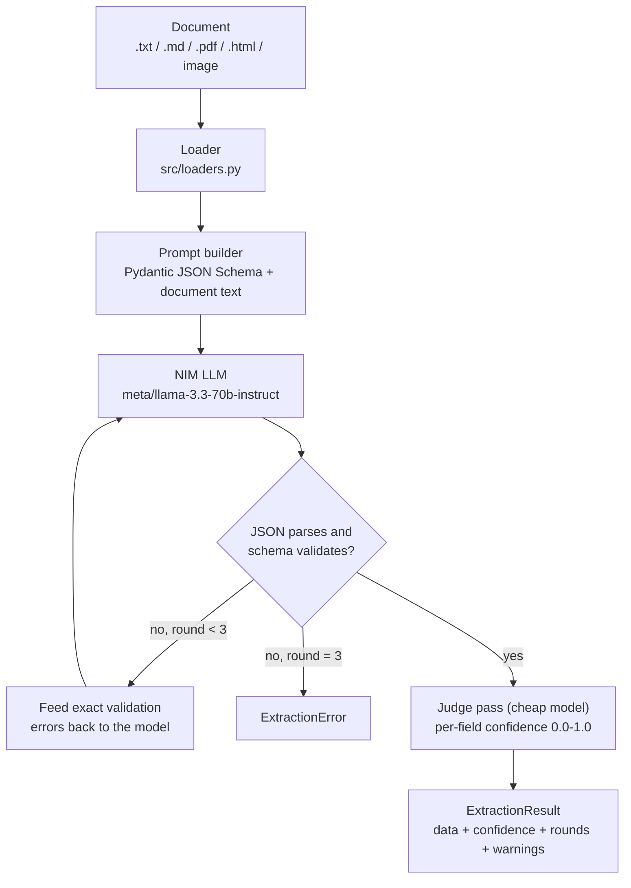

# Structured Extraction Agents

Turn messy documents into validated JSON — invoices, resumes, contracts, receipts — with Pydantic schemas, self-repair loops, confidence scoring, batch mode and a FastAPI endpoint.


## Why

"Extract this invoice as JSON" works in a demo and quietly rots in production. Free-form prompting gives you three failure modes that constrained extraction eliminates:

1. **Shape drift.** The model renames keys, nests things differently on Tuesdays, or returns markdown around the JSON. Here, the Pydantic model *is* the contract: its `model_json_schema()` goes into the prompt, and nothing leaves the pipeline until `model_validate()` passes.
2. **Confidently wrong numbers.** An LLM will happily report a total that its own line items do not add up to. Validators encode the business rules — line `amount == quantity * unit_price`, `subtotal == sum(lines)`, `total == subtotal + tax`, `due_date >= issue_date`, contract obligations must belong to an actual party. A bad extraction is not a silent bug; it is a `ValidationError` with a precise message.
3. **No feedback loop.** That error message is machine-actionable, so it goes straight back to the model: *"subtotal 2500.0 does not match the sum of line amounts (2480.0)"* is a far better repair prompt than "try again". Up to three rounds; the result records which round succeeded.

On top of that, a second cheap judge pass scores per-field confidence, so downstream code can auto-accept the easy 95% and route the shaky 5% to a human instead of trusting everything equally.

## How it works



Everything trust-related is explicit in the result:

- `rounds` — 1 means the model got it right first try; 2–3 mean the repair loop earned its keep.
- `confidence.fields` — per-field scores from the judge; `confidence.overall` is their mean.
- `warnings` — repair rounds taken, fields the judge could not score, fields under the 0.6 confidence bar.

## Quickstart

```bash
git clone https://github.com/HuzaifaAqeel/Structured-Extraction-Agents.git
cd Structured-Extraction-Agents
pip install -r requirements.txt
cp .env.example .env        # Windows: copy .env.example .env
```

Then get a free NVIDIA API key (about two minutes):

1. Go to [build.nvidia.com](https://build.nvidia.com) and sign up — free account, free credits, no card.
2. Open any model page and click **Get API Key**.
3. Copy the key (starts with `nvapi-`) into `.env` as `NVIDIA_API_KEY`.

Run the offline test suite any time — it mocks the LLM and needs no key:

```bash
pytest -q
```

Watch the self-repair loop in action without a key:

```bash
python demo_offline.py   # scripted LLM, real validation + repair pipeline
```

## Usage

### Extract one document

```bash
python cli.py extract invoice samples/invoice_01.txt --pretty
```

Expected output (abridged):

```json
{
  "data": {
    "vendor_name": "Cascada Cloudworks S.A.",
    "invoice_number": "INV-2026-0187",
    "issue_date": "2026-05-02",
    "currency": "USD",
    "line_items": [
      {"description": "Cloud infrastructure management (May 2026 retainer)", "quantity": 1.0, "unit_price": 1200.0, "amount": 1200.0}
    ],
    "subtotal": 2840.0,
    "tax": 198.8,
    "total": 3038.8
  },
  "confidence": {"overall": 0.94, "fields": {"vendor_name": 1.0, "total": 0.95, "vendor_tax_id": 0.9}},
  "rounds": 1,
  "warnings": []
}
```

Feed it the deliberately messy sibling (`samples/invoice_02_messy.txt` — OCR-style garbling, `1,200.00` vs `1 200.00`, `T0TAL` with a zero) and you will typically see `"rounds": 2` plus a warning explaining that the repair loop fired. Every doctype ships one clean and one messy sample for exactly this comparison.

Other subcommands:

```bash
python cli.py extract receipt photo_of_receipt.jpg --ocr --pretty   # image via NIM vision model
python cli.py extract resume samples/resume_02_messy.txt --pretty --min-confidence 0.8
python cli.py schemas --doctype contract                            # print the enforced JSON Schema
```

### Batch a folder

```bash
python cli.py batch invoice ./inbox --out results/invoices.jsonl --concurrency 6
```

```
[ok]  invoice_01.txt (confidence 0.94, round 1)
[ok]  invoice_02_messy.txt (confidence 0.88, round 2)
[err] not_an_invoice.txt: model output failed validation after 3 rounds; ...

Batch summary
  files:      3 (0 skipped, already done)
  succeeded:  2
  failed:     1
  confidence: 0.910 mean overall
  repairs:    round 1: 1, round 2: 1
  elapsed:    14.2s
```

Records append as each file finishes, so an interrupted run leaves a valid partial JSONL. Re-running the same command skips files that already succeeded and retries the failures (`--no-resume` reprocesses everything).

### FastAPI service

```bash
python cli.py serve            # or: uvicorn src.api:app --reload
```

```bash
# Extract an invoice
curl -s -X POST "http://127.0.0.1:8000/extract/invoice" \
  -F "file=@samples/invoice_01.txt"

# Raise the confidence bar -- low-confidence extractions come back as 422
# with the data, per-field scores and warnings in the detail payload
curl -s -X POST "http://127.0.0.1:8000/extract/receipt?min_confidence=0.85" \
  -F "file=@samples/receipt_02_messy.txt"

# The JSON Schemas the service enforces
curl -s http://127.0.0.1:8000/schemas | python -m json.tool

curl -s http://127.0.0.1:8000/health
```

The 422 behavior is deliberate: schema-valid but low-confidence output is a *review case*, not a success, and the API says so instead of letting it flow downstream.

## Accuracy tips

- **Field descriptions are micro-prompts.** The schema goes into the prompt verbatim, so write descriptions as instructions: `"Use 1 when the invoice does not state a quantity"` outperforms `"the quantity"`. All models in `src/schemas.py` follow this style — extend them the same way.
- **Temperature 0, always.** Extraction is transcription, not creativity. Both the extractor and the judge pin `temperature=0.0`.
- **Few-shot lives in the schema too.** For stubborn fields, add `json_schema_extra={"examples": [...]}` to the `Field(...)` — the examples ride along inside `model_json_schema()` without touching the prompt builder.
- **Validators should explain, not just reject.** The repair loop forwards validator messages to the model, so `"subtotal {x} does not match the sum of line amounts ({y})"` teaches it what to recompute. A bare `"invalid"` wastes a repair round.
- **Tune the tolerance to your documents.** `MONEY_TOLERANCE = 0.05` absorbs two-decimal rounding; tighten it for born-digital documents, loosen it for OCR input.
- **Use the judge threshold, not vibes.** Auto-accept above `0.85`, queue `0.6–0.85` for review, reject below — adjust with `CONFIDENCE_THRESHOLD` or per-request `?min_confidence=`.

## Adding a doctype

1. Write a Pydantic model in `src/schemas.py` with instruction-style field descriptions and validators for every cross-field rule you know.
2. Register it in `DOCTYPES`.

That is the whole change — CLI choices, batch mode, `/extract/{doctype}` and `/schemas` all read from the registry.

## Project structure

```
Structured-Extraction-Agents/
├── cli.py                    # extract / batch / schemas / serve commands
├── conftest.py               # makes src importable under pytest
├── requirements.txt
├── .env.example
├── src/
│   ├── schemas.py            # Pydantic models: Invoice, Resume, Contract, Receipt
│   ├── extractor.py          # prompt building, repair loop, confidence judge
│   ├── loaders.py            # .txt/.md/.pdf/.html/image -> text
│   ├── batch.py              # async folder -> JSONL with resume support
│   └── api.py                # FastAPI service
├── samples/                  # two fictional documents per type (one messy each)
└── tests/
    └── test_extractor.py     # schema rules, repair loop, judge, loaders -- offline
```

## License

MIT — see [LICENSE](LICENSE).
